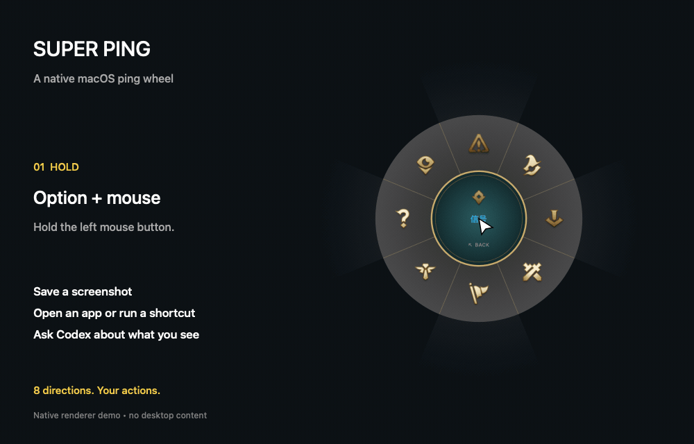
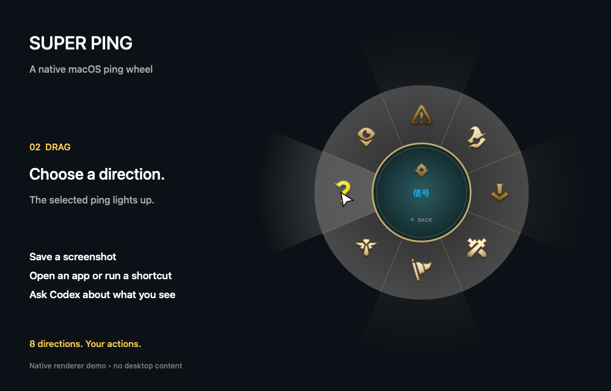
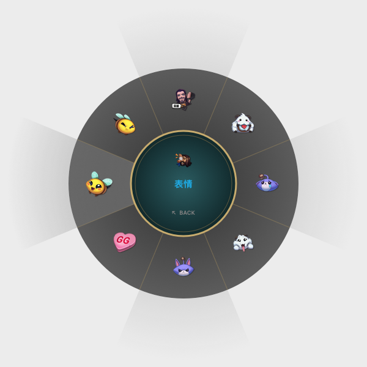

# Super Ping for macOS

**English** | [简体中文](README.zh-CN.md)



*Hold Option → drag to highlight → release to ping. Rendered with the app's native wheel and animation code; this demo does not run external actions.*

<details>
<summary>Static preview</summary>



</details>

A native macOS ping wheel rebuilt from [darrenprx/lolPing](https://github.com/darrenprx/lolPing), with customizable actions, screenshots that retain the ping marker, and Codex integration. Built with Swift, AppKit and SwiftUI—no Electron, Node.js or WebView runtime.

Requires **macOS 13 or later**. Release packages support both **Apple Silicon and Intel**. The app's settings interface is currently in Chinese; documentation is available in English and Chinese.

## Download and install

Download the universal DMG from [GitHub Releases](https://github.com/norvancc/super-ping/releases/latest), open it, and drag **Super Ping** into **Applications**. Quit any older version before launching the new one.

The 0.7.0 app and DMG are Developer ID signed and Apple notarized, with notarization tickets attached. The app passed macOS pre-distribution checks. Existing settings are preserved.

## Getting started

1. Enable Super Ping in **System Settings → Privacy & Security → Accessibility**. The app reconnects automatically; you can also use “重新连接” (Reconnect).
2. Hold **Option + left mouse button**, drag toward a ping, then release the mouse. The question mark is on the left. Return to the center, press Escape, right-click, or release Option to cancel.
3. Screenshot actions require **Screen Recording** permission. Restart the app after granting it. Allow Automation access when macOS asks to control Terminal or a supported browser.
4. Press **Control + Option + P** to pause or resume. Use the menu bar icon to open settings or quit.

“试用轮盘与 Hover” opens an interactive wheel preview without Accessibility permission. The wheel preview and “预览 Ping” do not execute configured actions.

## Actions

Each of the eight ping directions can have its own action.

| Action | Behavior |
| --- | --- |
| Show ping only | Display the animation and optional sound |
| Screenshot and ask Codex | Attach a marked screenshot and a customizable prompt |
| Save screenshot only | Save a marked PNG; do not launch Terminal or send it to AI |
| Screenshot to clipboard | Save the PNG and copy the image for pasting |
| Screenshot and preview | Save the PNG and open it with the default image app |
| Open web page | Open an HTTP or HTTPS address in the default browser |
| Open file or folder | Open a local file or folder with its default app |
| Run Shortcut | Run a macOS shortcut by its exact name |
| Copy text | Copy preset text to the clipboard |
| Open application | Select an `.app` or enter its bundle identifier |
| Run script | Run a shell script, AppleScript, or executable script |
| Run Mac command | Execute a custom command, including multiline commands |

Scripts and commands can run in Terminal or in the background. Background commands use `/bin/zsh -lc`; background jobs and Shortcuts have a 60-second timeout. Long-running or interactive scripts should run in Terminal. A timeout requests termination of the direct child process, not every process the script may spawn.

Shell scripts receive `PING_KIND`, `PING_X` and `PING_Y`; coordinates use the AppKit global coordinate system. `.sh`/`.zsh` files use zsh, `.bash` uses bash, and `.scpt`/`.applescript` uses osascript. Other scripts need an executable bit and a shebang. Commands run with the current user's permissions.

## Default question-mark action

The default question-mark ping captures the display containing the ping and opens Terminal with Codex, attaching the screenshot and the prompt **“What's this mean?”**.

Install Codex CLI and complete `codex login` first. The settings let you customize the executable path, working directory and prompt. The app passes the image through the CLI's `--image` argument and does not change Codex approval or sandbox settings. “Executed” means the launch command was handed to Terminal, not that Codex has completed a response.

All screenshot actions use the same capture sequence: hide the wheel, show the real ping animation, freeze it at 0.4 seconds, wait for drawing to settle, capture the display, save the PNG, and then hide the overlay. Terminal opens only after capture for the Codex action.

## Application and browser context

At the start of a ping, Super Ping records the topmost normal application window under the pointer. Codex prompts can include its application name, bundle ID and window title.

For Safari, Chrome (including Beta/Canary), Edge, Brave, Vivaldi and Chromium, the app attempts to read the selected tab's title and HTTP(S) URL from the matching browser window. It matches window bounds rather than falling back to an unrelated front window. It does not activate the browser or switch tabs.

If permission is denied, matching fails, or the background lookup times out, the screenshot is still sent with whatever context is available. A page URL does not give Codex access to authenticated page content. Window and page titles are appended as JSON data, separate from the user's question.

## Local data

- Settings: `~/Library/Application Support/PingAgent/settings.json`
- Screenshots: `~/Library/Application Support/PingAgent/Screenshots/`
- Codex captures also save a matching `.txt` containing the actual prompt.

The original internal data directory is retained for compatibility. Screenshots cover the entire display and may include other windows. They are not automatically deleted; open the screenshot folder from settings to manage them. Only the Codex action sends the screenshot to Codex; the three standalone screenshot actions remain local.

## Build and test

Install Xcode or Command Line Tools, then run:

```sh
bash scripts/build-app.sh
CLANG_MODULE_CACHE_PATH="$PWD/.build/clang-cache" swift test --disable-sandbox
```

The build creates `dist/Super Ping.app` for both CPU architectures. Local builds use ad-hoc signing by default. Rebuilding can require re-adding the app's Accessibility permission.

To produce DMG and ZIP archives:

```sh
bash scripts/package-release.sh
```

For a signed and notarized release, set `SIGNING_IDENTITY` to your Developer ID identity and `NOTARY_PROFILE` to your saved notarytool profile, then run the same packaging script. This submits the app and DMG to Apple's notarization service and attaches their tickets. Credentials and signing keys should never be committed to the repository.

To regenerate the README animation on macOS, install `ffmpeg` and run `bash scripts/build-demo.sh`. It uses the production native renderer with a scripted pointer path, without capturing the desktop.

## Scope and validation

Version 0.8.0 implements the upstream **local macOS features** against commit `f24a51e5a11c2b31dab72d89a571cc4025ad3c98`:

- All 11 Pings, original artwork/audio, All In clash, size/duration/volume controls and concurrent overlays.
- Drag-and-drop wheel editing, independent click center, configurable keyboard or Mouse 4/5 triggers, click sending, pause shortcut and hover sound.
- All 44 animated emotes and sounds, a separate emote wheel, and up to 24 custom PNG/JPEG/GIF/WebP emotes with rename/remove support.
- System/English/Chinese UI, light/dark appearance, launch at login, menu bar controls and verified, user-initiated update downloads.
- Existing screenshot, Codex, application/browser context and custom actions remain available.

Rooms and all networked room features are excluded. The upstream fullscreen-game detector is Windows-only and is not part of its macOS implementation. The settings interface uses native macOS controls; overlay geometry, assets and animation timings follow the upstream implementation.



Run `swift test` for the core regression suite and `bash scripts/verify-parity.sh` for production-renderer, asset, import and native input-routing checks. The latter needs a macOS graphical session. See [the parity audit](docs/UPSTREAM_PARITY.md) for evidence and hardware/system flows not exercised by automated tests. Browser context still depends on Automation permission and browser scripting support.

## Origin and license

Super Ping is a **native macOS rewrite and derivative project based on [darrenprx/lolPing](https://github.com/darrenprx/lolPing)**, created by **Danrui Meng**. It is not an official release of the upstream project. This version adds native macOS settings, configurable actions, marked screenshots, Codex integration and application/browser context.

Source code is licensed under the [MIT License](LICENSE). The original MIT copyright notice is preserved in [THIRD_PARTY_NOTICES.txt](THIRD_PARTY_NOTICES.txt), which is also bundled with the app.

The ping icons (including the question-mark app icon) emotes and sounds come from the upstream repository and are © Riot Games, Inc. They are **not covered by the MIT License**. Super Ping is not endorsed by or affiliated with Riot Games. See the third-party notices for the full attribution.
